# dubizzle AI — Used-Car Discovery, Memory & Booking Assistant

An end-to-end conversational used-car discovery, long-term memory, lead qualification, and viewing-booking assistant built for the dubizzle UAE inventory (`Copy_of_sample_cars_dataset.xlsx`).

**Core Design Principle:** *The LLM translates natural language into structured intent and helpful prose; Python and SQLite enforce ground truth, business rules, ownership isolation, and state.*

---

## Architecture Overview

```
┌───────────────────────────┐       HTTP (JSON)       ┌───────────────────────────────────┐
│   Streamlit Client        │ ◄─────────────────────► │   FastAPI REST Backend            │
│   frontend/               │   DubizzleAPIClient     │   backend/api/                    │
│   - Chat & Cards UI       │                         │   - AgentOrchestrator & Guardrails│
│   - Sidebar & Memory UI   │                         │   - Services & Domain Validators  │
│   - Booking Proposal Flow │                         │   - SQLite + FTS5 Repositories    │
└───────────────────────────┘                         └───────────────────────────────────┘
                                                                      │
                                                                      ▼
                                                       SQLite (WAL + FTS5) + CSV Lead Sync
```

### Key Technology & Architecture Justifications

1. **Streamlit + FastAPI REST Separation vs. Notebook / Monolith:**
   - Exposes every capability (inventory search, user memory, session focus/reference resolution, bookings, leads, chat) behind clean, testable FastAPI endpoints (`/inventory`, `/users/{id}/snapshot`, `/chat`, `/bookings/*`, `/leads/*`).
   - `frontend/` imports zero database drivers (`sqlite3`), zero Gemini SDKs, and zero backend business modules—enforced automatically in `tests/test_frontend.py`. Any web, mobile, or CLI client can replace Streamlit cleanly.
2. **SQLite + FTS5 + Deterministic Regex/Rule Extraction vs. Vector DB / RAG:**
   - Buyer queries on used cars depend on exact numeric bounds (`max_price <= 80000`, `mileage_km <= 50000`), exact boolean/enum attributes (`spec_region = 'GCC'`, confirmed exterior `colour`), and distinguishing cash prices from monthly instalments (`AED 1,611/mo`).
   - Vector similarity blurs numbers and conflates instalments with cash prices. Deterministic regex/rule extraction with verifiable evidence snippets stored in normalized SQLite tables + FTS5 keyword ranking guarantees zero fabricated attributes and strict SQL filtering.
3. **Direct `google-genai` Bounded Tool Loop vs. LangChain:**
   - Direct `google-genai` integration uses typed Pydantic tool schemas, deterministic iteration budgets (`AGENT_MAX_TOOL_CALLS`), duplicate-call prevention, model fallback (`gemini-3.1-flash-lite` → `gemini-3.5-flash` → `gemini-3.5-flash-lite` → `gemini-3.8-flash`), and clean offline mocking via `LLMClient` without framework abstraction overhead.
4. **Relational SQLite Memory Tables with Provenance vs. Unstructured JSON:**
   - Preferences, contradiction audit history (`preference_history`), recent searches, saved favourites, session context (`last_result_ids`, `current_vehicle`), and viewing bookings persist cleanly across sessions and restarts with strict per-user isolation, `original_wording` provenance checks, USD→AED reference conversion, and atomic `Forget Me` cascade deletion.

---

## Dataset Handling (`Copy_of_sample_cars_dataset.xlsx`)

The workbook contains two sheets:
- **`raw dataset` (Authoritative Source — 100 rows, 29 makes):** Preserves real noisy listings (`<br>` tags, RTL/Bidi marks, Arabic/English mix, phone numbers, URLs, instalment ads, and exact makes such as Listing `#87` Honda CR-V).
- **`cleaned dataset` (100 rows, 35 makes):** Pre-altered sheet omitted because it contains synthetic/missing entries (e.g., 0 Honda listings).

Ingestion reads **`raw dataset`** deterministically (`ADR-001`), never modifies the source Excel file, strips raw phones/URLs from `description_display`, separates `cash_price` (`confirmed`) from `monthly_instalment` and `down_payment`, labels model-derived body types and optional warranty mentions as `inferred`, and groups exact/near-duplicate template ads (`duplicate_group`) transparently.

---

## Core Capabilities

- **Grounded Natural-Language Search (`GET /inventory`, `search_inventory`):**
  - Supports structured filters (`make`, `model`, `min_year`/`max_year`, confirmed `min_price`/`max_price`, `min_mileage`/`max_mileage`, `spec_region`, `body_type`, `transmission`, `colour`, confirmed `warranty`) + sanitized FTS5 `free_text`.
  - Unknown values never satisfy positive filters and are counted transparently (`excluded_unknown_price`, `excluded_unknown_attributes`).
  - Alias normalization (`merc` → `mercedes-benz`, `crv` → `cr-v`, `gray` → `grey`) and single-query grounded suggestions (`GET /inventory/suggested-prompts`).
- **Deterministic Multi-Turn Reference Resolution (`POST /sessions/{id}/resolve`):**
  - Resolves explicit `#ID`, single and multi-ordinal references (`"the first one"`, `"compare the second and third"`, `"last one"`), `"previous vehicle"` comparisons, saved vehicles, and focused context strictly in Python from persisted session state.
  - Enforces deterministic resolution even if the LLM invokes `get_listing_details` directly on a relative phrase.
- **Post-Generation Grounding & Guardrails:**
  - Pre-LLM checks block prompt injections, competitor recommendations, and pure off-topic queries deterministically; mixed requests decline off-topic clauses while executing valid automotive queries.
  - Post-LLM verification checks AED prices, mileage figures, warranty status, transmission, spec region, colour, body type, engine, and column-by-column Markdown comparison tables against tool outputs, plus system-prompt and PII redaction.
- **Two-Step Viewing Bookings & Lead Qualification:**
  - Validates Monday–Saturday 08:00–20:00 `Asia/Dubai` (latest start `19:00`, min 2-hour notice), calendar weekday agreement (e.g. rejects `"Friday, November 14, 2026"` when Nov 14 is Saturday), rejects vague times (`morning`/`afternoon`) without inventing hours, and offers valid nearest alternatives.
  - Strictly separates `proposed` drafts from `confirmed` reservations using atomic SQLite `BEGIN IMMEDIATE` slot conflict protection.
  - Deterministically scores buyer leads (`COLD` / `WARM` / `HOT`), masks phone numbers in buyer-facing API responses, traces, and logs, and keeps unmasked `leads.csv` / `GET /leads` exports restricted behind `ADMIN_API_KEY`.

---

## Technology Stack

| Layer | Technologies |
| :--- | :--- |
| Frontend UI | Streamlit (`1.67`), HTTPX (`0.28`), custom CSS light/dark theme tokens |
| Backend API | FastAPI (`0.162`), Uvicorn (`0.54`), Pydantic v2 (`2.14`) |
| LLM Integration | Official Google GenAI SDK (`google-genai 3.0.0`) with bounded tool calling & failover |
| Data & Search | SQLite (`WAL` mode + `FTS5` BM25 search), Pandas (`3.1`), OpenPyXL (`3.1`) |
| Quality & Tooling | Pytest (`9.2`), `pytest-asyncio`, Ruff (`0.17`), `uv` / `venv` |

---

## Quickstart

### 1. Environment Setup

```bash
python3 -m venv .venv
source .venv/bin/activate
pip install -e ".[dev]"
# or with uv:
# uv sync --extra dev

cp .env.example .env
# Add your Gemini API key to .env (GEMINI_API_KEY=...)
```

> If `GEMINI_API_KEY` is omitted or unreachable, the backend runs cleanly in **degraded mode** (inventory search, vehicle cards, saved favourites, direct filter UI, and viewing bookings remain fully operational).

### 2. Run Backend & Frontend

**Terminal 1 — FastAPI Backend (auto-ingests 100 listings on startup):**
```bash
uvicorn backend.main:create_app --factory --host 127.0.0.1 --port 8000 --reload
```
API docs available at `http://127.0.0.1:8000/docs`.

**Terminal 2 — Streamlit Client:**
```bash
streamlit run frontend/app.py --server.port 8501
```
Open `http://127.0.0.1:8501`.

### 3. Environment Variables

Copy `.env.example` to `.env`. Only `GEMINI_API_KEY` is needed for full AI chat mode:

| Variable | Default | Purpose |
| :--- | :--- | :--- |
| `GEMINI_API_KEY` | `""` | Google Gemini API key (empty triggers degraded structured-only mode) |
| `GEMINI_MODEL` | `gemini-3.1-flash-lite` | Primary Gemini model before configured failover models |
| `DATABASE_URL` | `data/database/dubizzle.db` | SQLite file path (auto-ingests `Copy_of_sample_cars_dataset.xlsx` if empty) |
| `EXPORTS_DIR` | Derived from DB dir | Directory for generated `leads.csv` exports (`data/exports` by default) |
| `ADMIN_API_KEY` | `""` | Shared key (`X-Admin-Key` / `Authorization: Bearer`) gating `/leads` & `/leads/export` |
| `APP_ENV` / `LOG_LEVEL` | `development` / `INFO` | Runtime environment and logging verbosity |
| `BOOKING_MIN_LEAD_TIME_HOURS` | `2` | Minimum advance notice for Dubai viewing proposals |
| `BOOKING_VIEWING_DURATION_MINUTES` | `60` | Fixed slot duration (Monday–Saturday, 08:00–20:00 `Asia/Dubai`) |
| `USD_TO_AED_RATE` | `3.6725` | Fixed reference conversion rate for USD buyer budgets |
| `AGENT_MAX_TOOL_CALLS` | `5` | Maximum bounded tool-loop iterations per chat turn |
| `GEMINI_REQUEST_TIMEOUT_MS` | `20000` | Per-call Gemini HTTP timeout in milliseconds |
| `AGENT_TURN_TIMEOUT_SECONDS` | `45.0` | End-to-end backend deadline per chat turn |
| `DUBIZZLE_API_URL` | `http://127.0.0.1:8000` | Backend base URL used by Streamlit `DubizzleAPIClient` |
| `DUBIZZLE_API_TIMEOUT` / `DUBIZZLE_CHAT_TIMEOUT` | `12.0` / `60.0` | Frontend request and chat timeouts in seconds |

### 4. Demo Instructions (End-to-End Buyer Journey)

1. Start both servers above and open `http://127.0.0.1:8501` (auto-creates an isolated guest profile `buyer_<hex>`).
2. **Search & Follow-Up:** Ask *"Show me Mercedes-Benz GCC SUVs under 400,000 AED"*, or open **Filter Inventory** to verify strict numeric filtering. Then ask a contextual follow-up (*"Tell me the cash price, mileage, and warranty of the first one"*).
3. **Preferences & Favourites:** Save a budget or colour preference in the sidebar or via chat, and click **Save** on a listing card.
4. **Enquiry & Viewing Booking:** Open **My Enquiry** in the top bar (or **My Enquiry Profile** in the sidebar) to enter contact/qualification details (`+971...`), then open **Book Viewing** to propose a Monday–Saturday `08:00–19:00 Asia/Dubai` slot and confirm it via the confirmation checkbox + **Confirm Viewing** (buyer views display masked phone numbers while SQLite stores the normalized record).
5. **Continuity & Forget Me:** Click **New chat** in the sidebar to verify returning-user welcome continuity, then open **Forget Me (delete my data)**, tick **Confirm permanent deletion of all my data**, and click **Delete All My Data** (removing DB rows and purging the user from `leads.csv`).

### 5. Verification & Quality Checks

```bash
# Lint
.venv/bin/ruff check .

# Full offline & UI test suite
.venv/bin/pytest -v
```

### 6. Known Limitations

- **Prototype Identity vs. Production Auth:** Buyer sessions use self-asserted `user_id` profile scoping (with strict per-resource ownership checks on sessions, bookings, and preference provenance, plus `ADMIN_API_KEY` on admin lead routes) rather than signed HTTP-only cookies or OAuth2/JWT login ([Architecture Principle #5](docs/architecture.md)).
- **No Arabic NLP (`ADR-005`):** Predominantly Arabic descriptions (`9` listings) and mixed listings (`8`) are flagged by language, while attribute extraction targets English/bilingual numeric patterns.
- **Template Near-Duplicates (`ADR-004`):** Without VIN/plate identifiers in the supplied dataset, identical dealer descriptions are grouped transparently via `duplicate_group` rather than merged into one physical car.
- **Single-Node SQLite Persistence:** Designed for single-host take-home evaluation using SQLite WAL transactions and atomic temp-file replacement for `leads.csv`.

---

## Key API Endpoints

| Domain | Endpoints |
| :--- | :--- |
| Health | `GET /health` |
| Inventory | `GET /inventory`, `GET /inventory/makes`, `GET /inventory/suggested-prompts`, `GET /inventory/summaries`, `GET /inventory/{listing_id}` |
| Users & Memory | `POST /users`, `GET /users/{id}`, `GET /users/{id}/snapshot`, `DELETE /users/{id}?confirm=true`, `GET/PUT /users/{id}/preferences`, `DELETE /users/{id}/preferences/{preference_key}`, `GET /users/{id}/searches`, `GET /users/{id}/returning-summary`, `GET/POST /users/{id}/favourites`, `DELETE /users/{id}/favourites/{listing_id}` |
| Sessions & Chat | `POST /sessions`, `GET /sessions/{id}`, `POST /sessions/{id}/focus`, `POST /sessions/{id}/resolve`, `POST /sessions/{id}/search`, `POST /chat` |
| Bookings & Leads | `POST /bookings/propose`, `POST /bookings/{id}/confirm`, `GET /bookings/{id}`, `GET /users/{id}/bookings`, `PUT /leads/{user_id}`, `GET /leads/{user_id}`, `GET /leads` (admin `ADMIN_API_KEY`), `GET /leads/export` (admin `ADMIN_API_KEY`) |

---

## Documentation

- [Architecture & Component Boundaries](docs/architecture.md)
- [Engineering Decisions (ADR-001 to ADR-008)](docs/decisions.md)
- [Deterministic Extraction Specification](docs/extraction_spec.md)
- [Evaluation Prompt Suite](eval/gold.csv)

---

## UI Screenshots

| Welcome Workspace Home | Structured Inventory Filters |
| :---: | :---: |
| 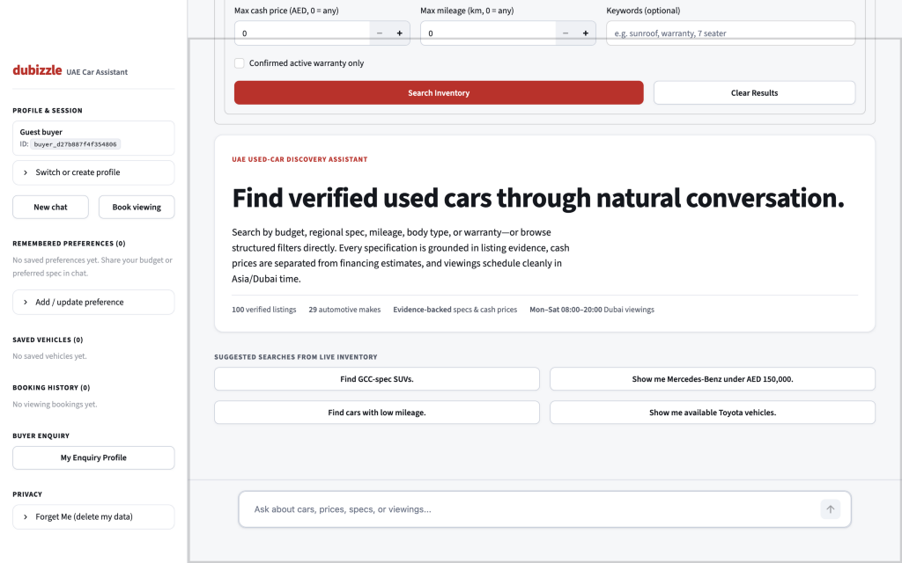 | 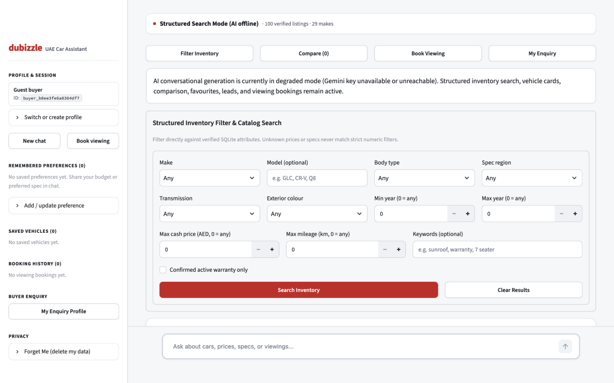 |

| Grounded Search Results | Vehicle Details & Provenance Modal |
| :---: | :---: |
| 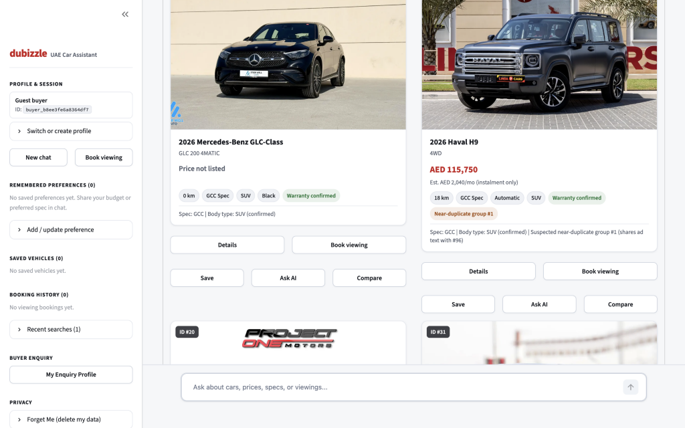 | 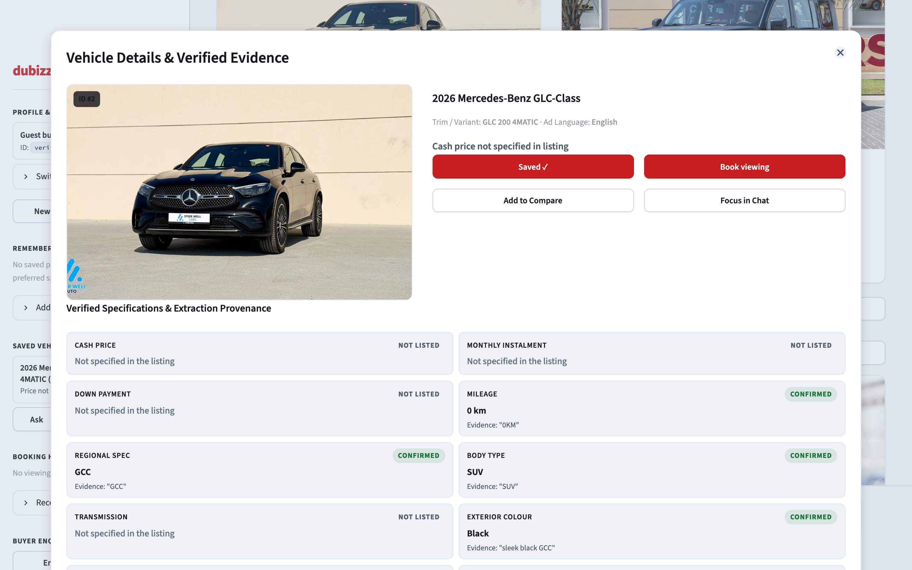 |

| Side-by-Side Comparison Modal | Saved Vehicles & Buyer Workspace |
| :---: | :---: |
| 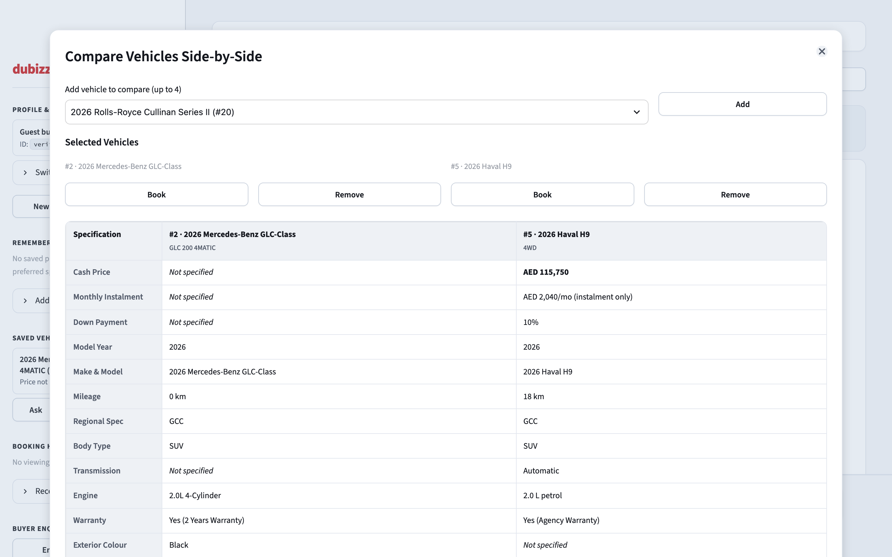 | 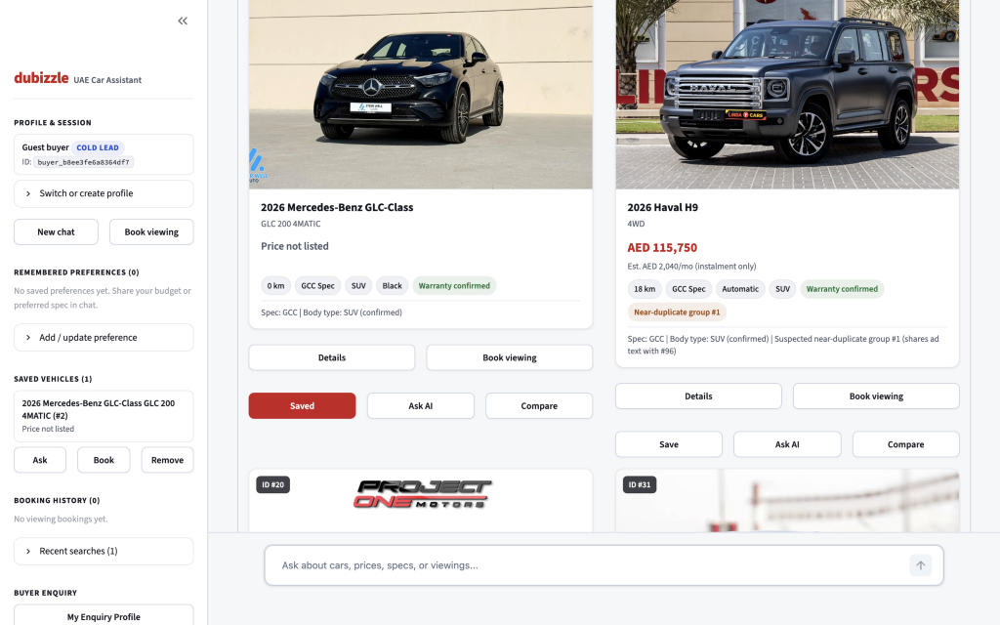 |

| Viewing Proposal (Unreserved Draft) | Confirmed Viewing Reservation |
| :---: | :---: |
| 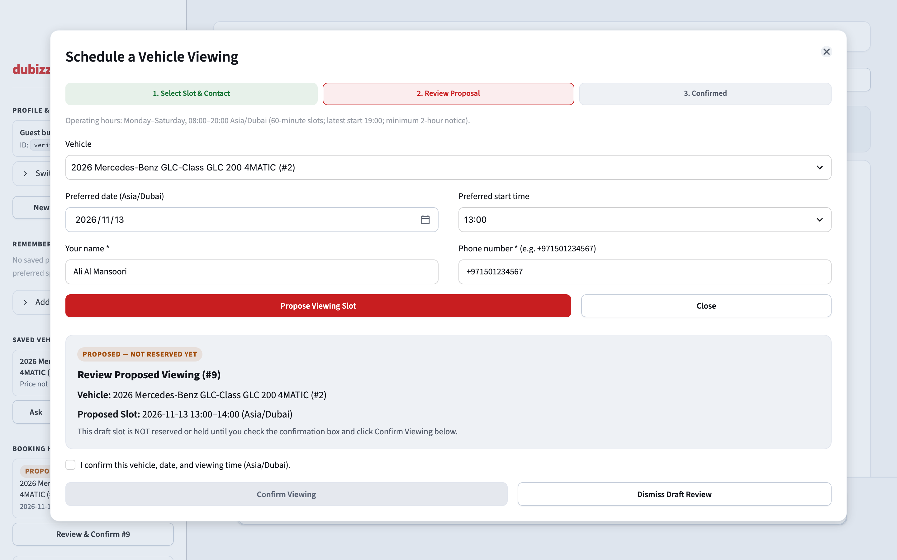 | 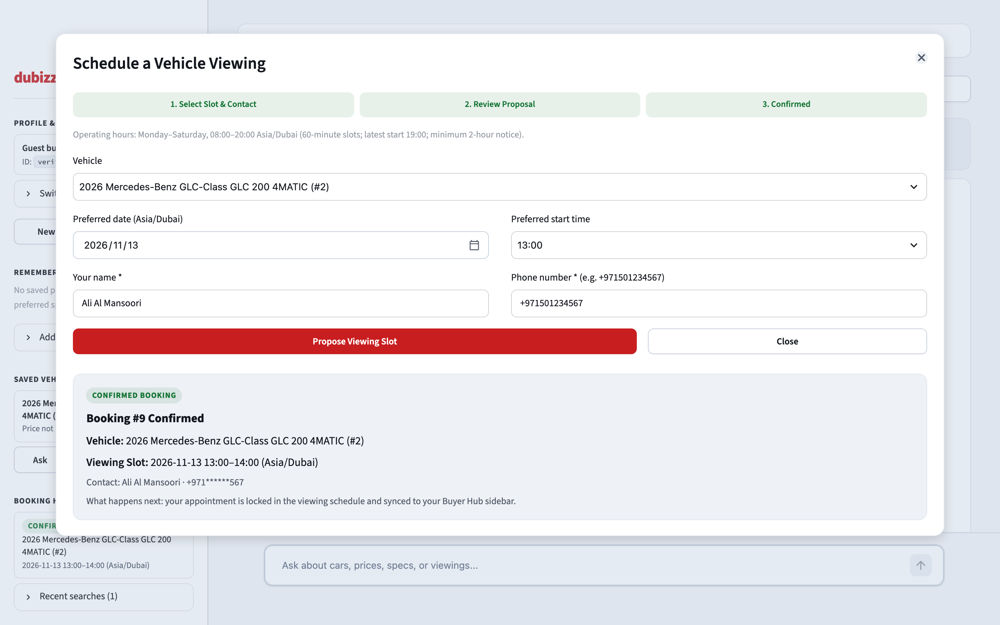 |

| Returning User Memory & Continuity | Mobile Responsive Layout (390×844) |
| :---: | :---: |
| 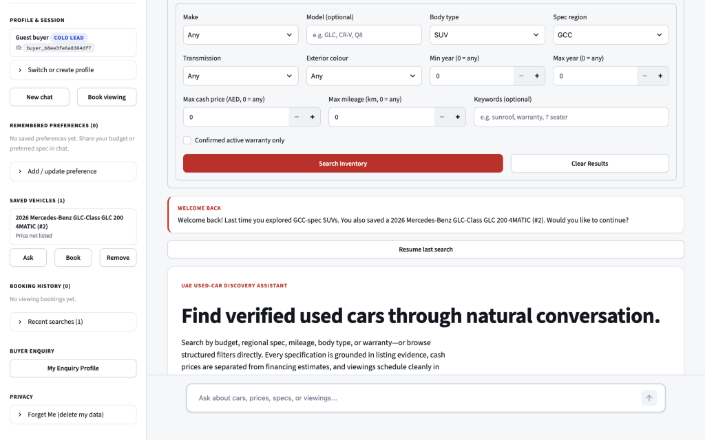 | 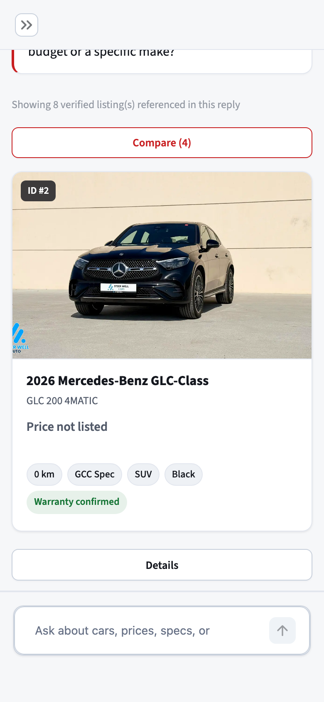 |

| Backend Unreachable Guard | |
| :---: | :---: |
| 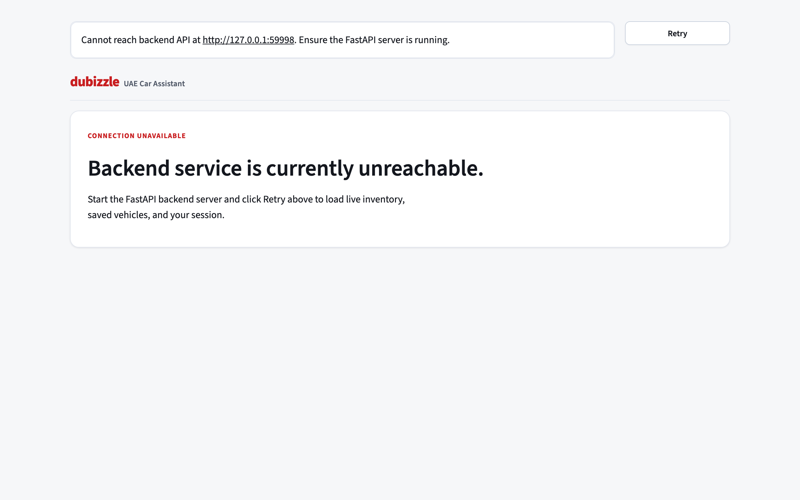 | |
